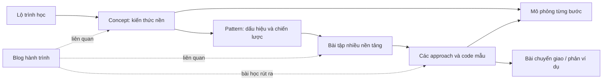

# Hướng sản phẩm: Portfolio, Blog và DSA Learning Hub

Baseline v3 — 22/09/2026. Mục tiêu: vừa học công nghệ, vừa ghi lại quá trình học, vừa tạo tài liệu giúp người khác tiến bộ. Giá trị đến từ trình tự và lập luận do tác giả kiểm chứng, không phải số lượng bài hoặc giao diện giống một nền tảng lớn.

## Ba trải nghiệm, một hệ thống

| Không gian | Người dùng đến để | Giao diện |
|---|---|---|
| Portfolio | Hiểu bạn là ai, đã làm gì và đóng góp ra sao | Giữ VS Code theme hiện có |
| Blog | Đọc quan điểm, kỹ thuật, câu chuyện và hành trình | BlogLayout riêng, typography dễ đọc, series và bài liên quan |
| Learning Hub | Học theo lộ trình, hiểu kiến thức, luyện bài và ôn lại | Sheet/map, lesson reader, problem workspace |

Blog riêng trước hết là riêng về navigation, layout và nội dung; chưa giả định bạn mua domain riêng hoặc muốn một repo khác. Cùng domain với `/blog`, `/learn`, `/practice` làm auth, link và deployment dễ hơn. Khi thêm domain triển khai, giữ React và cùng contract Spring API.

## Tham khảo và khác biệt

Trang [Striver A2Z](https://takeuforward.org/prep-hub/strivers-a2z-dsa-sheet) tổ chức syllabus theo module, kết hợp lý thuyết và bài luyện, có tiến độ học. Điều nên học là cấu trúc và nhịp luyện tập. Trang tham khảo được đọc ở mức trang public; không đánh giá phần có login hoặc toàn bộ workspace nội bộ.

Không cần sao chép số lượng bài, đề, editorial hay UI. Roadmap của bạn bắt đầu nhỏ, có mục tiêu và điều kiện đầu vào rõ; mỗi liên kết bài tập cần giải thích vì sao bài đó phù hợp với bước học. Đây là quyết định sản phẩm của dự án, không phải tính năng được suy ra từ trang tham khảo.

## Liên kết nội dung

Ví dụ: bài blog “Tôi từng nhầm khi di chuyển con trỏ” kể câu chuyện, lỗi và bài học; concept “Mảng có thứ tự” dạy kiến thức nền; pattern “Two pointers trên mảng đã sắp xếp” giải thích điều kiện; problem “Tìm cặp có tổng mục tiêu” dẫn tới source thực hành; solution giải thích invariant và có dry run. Không copy toàn bộ solution vào bài blog, chỉ trích phần cần kể và link đến bản chuẩn.

## Curriculum ban đầu

Mục tiêu người học: biết một ngôn ngữ cơ bản và muốn học DSA có hệ thống. Mỗi module ghi prerequisites, outcomes, thời lượng **ước lượng**, câu kiểm tra và bài bắt buộc/tùy chọn. Không khóa cứng người đọc vì họ tự đánh giá đã biết phần trước.

Thứ tự đề xuất: Big-O và cách tự kiểm tra → arrays/strings → hashing → sorting/binary search → two pointers/sliding window → recursion → linked lists → stack/queue → trees/heaps → graph traversal → greedy/DP cơ bản. Đây là một đường học có thể điều chỉnh, không phải đường tối ưu cho mọi mục tiêu.

Release đầu chỉ biên soạn kỹ 3–4 module đầu. Hiển thị các module chưa có nội dung là “dự kiến” riêng khỏi progress, không dựng hàng trăm link trống. Đến cuối kế hoạch: khoảng 10–12 lessons, 6–8 patterns, 25–35 bài có editorial tốt, 6 visualizers. Phủ đầy DSA và hàng trăm editorial là công việc tiếp diễn sau release.

## Roadmap page

Sheet là view mặc định: section mở/gấp, prerequisites, outcomes, item loại lesson/pattern/problem, difficulty nội bộ, source badges, nội dung khả dụng, trạng thái và thời lượng dự kiến. Có filter theo platform/pattern/difficulty và nút tiếp tục mục đang học.

Map là view bổ sung của cùng dữ liệu; cạnh thể hiện tiên quyết, node link lesson/pattern. Không dùng đồ thị rối thay cho mục lục. Progress đọc hiểu và progress giải bài được báo riêng; “đã xem lời giải” không phải “đã tự giải”. Khách có checkbox local và export/import; ghi rõ “Lưu trên trình duyệt này”. Sync đa thiết bị là extension cần tài khoản, chưa nằm trong bản 9 tháng.

## Trang concept và pattern

Concept: mục tiêu → mô hình trực giác → operations và complexity có điều kiện → visualization → ví dụ/edge cases → checkpoint → bài tập.

Pattern: dấu hiệu nhận biết → điều kiện áp dụng → invariant → template pseudocode → trường hợp không áp dụng → bài mẫu → bài chuyển giao. Ví dụ sliding window cần giải thích khi nào điều chỉnh cửa sổ là hợp lệ; không dạy “gặp subarray thì luôn dùng sliding window”.

## Problem workspace

Desktop chia hai vùng: trái là bài toán/phân tích/gợi ý; phải là visualization/pseudocode/code mẫu. Mobile xếp tab đọc được và giữ các nút điều khiển gần visual. Có source badge và nút “Giải trên nền tảng gốc”. Code editor tùy chọn về sau là scratchpad; không có Run/Submit giả.

Luồng học:

1. **Hiểu:** đọc diễn giải tự viết, input/output/constraints hợp lệ, nhắc kiến thức nền. Đề đầy đủ dẫn nguồn khi không lưu bản được phép.
2. **Thử:** đề xuất brute force; câu hỏi “điểm nào đang lặp lại?”; người học thử tại nguồn hoặc ghi suy nghĩ local.
3. **Gợi ý:** mở từng tầng: quan sát → pattern → invariant → pseudocode. Không tự bật toàn bộ code.
4. **Khám phá:** dự đoán bước kế tiếp, chạy step, nhìn biến/state thay đổi và đọc vì sao.
5. **Lập luận:** tại sao chọn cấu trúc này, tại sao đúng, có bỏ sót nghiệm không, complexity đến từ đâu.
6. **So sánh:** brute force/optimized, thời gian/bộ nhớ, điều kiện áp dụng và trade-off; không gắn nhãn “optimal” thiếu lý do.
7. **Chuyển giao:** đổi một constraint hoặc giới thiệu bài tương tự; yêu cầu giải thích điều gì còn đúng và điều gì phải đổi.
8. **Ôn:** tự đánh giá “chưa hiểu/hiểu khi đọc/tự làm được”, ghi lỗi và hẹn ôn; nhìn lại không tính là mastery.

Khác biệt với một trang đáp án thông thường là **dạy quyết định và kiểm tra khả năng chuyển giao**. Layout hai cột chỉ hỗ trợ điều đó; sao chép layout không tự tạo giá trị.

## Một ví dụ để tác giả tự học và truyền đạt

Bài tự biên soạn: mảng tăng `[1, 3, 4, 6, 8]`, tìm cặp tổng 10.

- Brute force kiểm tra cặp, O(n²) thời gian/O(1) bộ nhớ phụ.
- Sorted two pointers: l=0, r=4, tổng 9; tăng l vì với giá trị 1, mọi r nhỏ hơn đều có tổng ≤9. Tổng kế tiếp 11; giảm r vì với giá trị 8, mọi l lớn hơn đều có tổng ≥11. Sau đó 3+6=9, tăng l; 4+6=10, tìm thấy.
- Invariant: mọi cặp đã loại không thể là nghiệm; vùng còn lại vẫn chứa nghiệm nếu có. O(n) thời gian khi input đã sorted, O(1) bộ nhớ phụ.
- Phản ví dụ: input chưa sorted thì lập luận loại vùng không còn đúng. Nếu phải trả index gốc, sorting cần bảo toàn index; hash map là một lựa chọn khác với O(n) bộ nhớ phụ và thời gian kỳ vọng O(n).
- Checkpoint: “Nếu tổng quá nhỏ, tại sao giảm r không giúp?”; transfer: “Nếu cần liệt kê mọi cặp duy nhất thì duplicates thay đổi cách di chuyển thế nào?”

Trình bày đây là ví dụ tự biên soạn; không tự gán nó là nguyên đề một nền tảng.

## Thiết kế visualizer

V1 viết các hàm TypeScript đã review: `buildTrace(input) -> Step[]`. Step chứa state trước/sau hoặc snapshot nhất quán, active pseudocode line IDs, text explanation và operation count. Player chỉ chọn step, play/pause/next/previous/reset/speed; đổi input reset trace. V1 editorial ưu tiên code Java; code được đối chiếu kết quả bằng fixtures, không giả vờ trace được thực thi từ code Java.

Chọn 6 visualizers: binary search, two pointers, sliding window với điều kiện rõ, stack operations, linked-list reversal, BFS. Mỗi cái có input giới hạn (ví dụ array 30 phần tử, graph 20 nodes/40 edges, tối đa 5.000 steps), preset edge cases và kết quả mong đợi. Giới hạn này là cấu hình ban đầu cần đo trên mobile.

Không chạy JavaScript/Java do khách hoặc CMS cung cấp. Nếu trace tốn thời gian, chuyển thuật toán đã kiểm soát vào Web Worker, timeout/cancel. Có text table thay thế animation, reduced motion và keyboard controls. React Flow phục vụ sơ đồ; SVG/React phù hợp với array/pointers; không cần đưa mọi mô phỏng vào engine đồ thị.

## Quy trình xuất bản kiến thức

Tự làm trước → ghi lại sai lầm → học/đối chiếu nguồn → viết lập luận bằng lời mình → test code và trace → kiểm tra bằng phản ví dụ → viết checkpoint/transfer → publish lesson/solution → viết blog journey nếu có câu chuyện đáng kể.

Trạng thái nội dung vẫn DRAFT/PUBLISHED/ARCHIVED; checklist chất lượng nằm trước publish. Ghi “last reviewed” và nguồn tham khảo. Nếu chưa chắc, giữ draft hoặc ghi giới hạn rõ. Mẫu biên soạn ở [learning-content](templates/learning-content.md). Người học không cần được thuyết phục rằng tác giả biết hết; họ cần nội dung trung thực, kiểm chứng được và có đường đi rõ.
