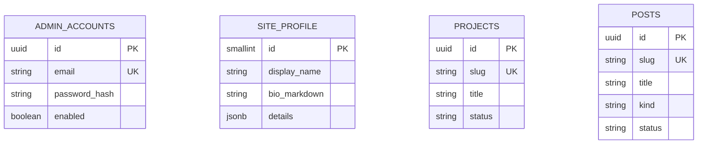
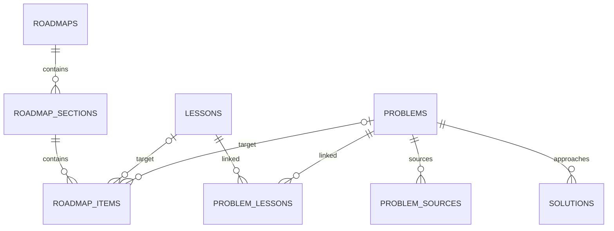

# Phân tích database vừa đủ để triển khai

Baseline tối giản — 22/09/2026. **Thiết kế đề xuất, chưa tạo database, migration hay entity.** Tài liệu này có ưu tiên khi triển khai schema so với danh sách bảng mở rộng ở tài liệu 04/10; các yêu cầu sản phẩm vẫn giữ, nhưng bảng được tạo theo nhu cầu thực tế.

## 1. Phạm vi và nguyên tắc

Một chủ sở hữu viết nội dung; khách chỉ đọc và có tiến độ local. Chưa có nhiều tác giả, phân quyền phức tạp, đồng bộ tài khoản người học hoặc cộng đồng đóng góp. Database PostgreSQL, Java/Spring Data JPA, schema do Flyway quản lý khi bắt đầu code.

Tách bảng khi dữ liệu có vòng đời riêng, cần truy vấn riêng hoặc quan hệ cần FK. Dữ liệu nhỏ chỉ chỉnh cùng một đối tượng có thể nằm trong JSONB. Không đưa tất cả nội dung vào một bảng generic; cũng không tạo một bảng cho từng nhãn hoặc dòng trên giao diện.

**MVP portfolio + blog cần 4 bảng.** Learning Hub thêm 8 bảng khi đến giai đoạn đó. Progress, RAG, habit, vision chỉ thiết kế/triển khai chi tiết khi kích hoạt tính năng.

## 2. Quy ước chung

- UUID do ứng dụng tạo; không cần thêm extension chỉ để sinh ID.
- Các aggregate chỉnh sửa có created_at, updated_at dạng timestamptz và version bigint cho optimistic locking.
- Slug lowercase, unique theo loại nội dung, không đổi sau lần publish đầu trong bản đầu.
- Nội dung public dùng status DRAFT/PUBLISHED/ARCHIVED. Chỉ PUBLISHED được đọc public; DRAFT và ARCHIVED chỉ admin. **Không cần thêm visibility** ở bản đầu vì chưa có nội dung published dành riêng người dùng. Personal tables luôn private theo loại dữ liệu.
- published_at nullable; PUBLISHED bắt buộc có published_at. Giữ ngày publish đầu khi unpublish/republish, updated_at thể hiện lần cập nhật mới. Thêm DB check phù hợp.
- Enum lưu text có CHECK constraint. Không tạo bảng status/role/difficulty chỉ để chứa vài hằng số.
- Nullable chỉ dùng khi field thật sự tùy chọn; email/slug chuẩn hóa trước khi ghi, DB giữ unique.
- v1 chỉnh bài published là sửa bản live, tăng version. Chưa có hệ thống revision editor nháp song song.

Contract API hiện có có visibility PUBLIC/PRIVATE thì cần sửa theo spec của slice trước khi implement: nội dung public chỉ nhận status; hành vi draft/private không lộ vẫn phải giữ. Không âm thầm nhận rồi bỏ qua visibility do client gửi.

## 3. Bốn bảng đầu tiên

### admin_accounts — tài khoản quản trị

| Field | Kiểu / quy tắc |
|---|---|
| id | UUID PK |
| email | varchar(254), NOT NULL, unique trên email đã lowercase/trim |
| password_hash | text, NOT NULL; hash qua Spring Security |
| enabled | boolean, NOT NULL, mặc định true |
| created_at, updated_at, version | Theo quy ước |

Bootstrap một account. Không mở đăng ký; nghiệp vụ chưa cần bảng roles, permissions, user_roles hoặc refresh_tokens. Session do Spring Security quản lý, không thiết kế bảng session riêng ngay. Email đăng nhập không được tự động dùng làm email công khai trên profile.

### site_profile — hồ sơ công khai

Một bản ghi toàn site, không phụ thuộc account dùng để đăng nhập. id là smallint PK với CHECK id=1 (tối đa một hàng); tạo qua seed hoặc lần lưu profile đầu.

| Field | Kiểu / quy tắc |
|---|---|
| display_name | varchar(100), NOT NULL |
| headline | varchar(200), NOT NULL |
| bio_markdown | text, NOT NULL |
| details | jsonb object, NOT NULL, mặc định object rỗng |
| updated_at, version | Timestamp và optimistic lock |

details chứa cấu trúc được Java DTO validate: roles, greeting, company, typingTexts, focusItems, socials, skillGroups, certifications, publicContact, customStats. Đây là dữ liệu nhỏ render và lưu như một hồ sơ; array giữ thứ tự, không cần bảng riêng cho từng dòng kỹ năng/liên hệ. Mỗi collection giới hạn size; URL chỉ nhận scheme được phép; dùng DTO cụ thể thay vì Map tùy ý.

Số project/blog public suy ra từ bảng thật, không lưu số đếm trùng. Sau này chỉ tách skills/certifications thành bảng khi cần quản lý/truy vấn độc lập. Không dùng JSONB profile để nhét project/blog vào.

### projects — showcase và case study

id, slug varchar(120) unique, title varchar(160), summary varchar(500), body_markdown text, tech_stack text[] mặc định rỗng, repo_url/live_url nullable, lifecycle_status BUILDING/COMPLETED/OPERATING, featured boolean, sort_order integer, status, published_at, created_at, updated_at, version.

Vai trò cá nhân, team size, kết quả và bài học viết có cấu trúc trong body_markdown ở MVP; chỉ thêm cột khi thật sự cần filter hoặc UI dữ liệu riêng. Emoji/category có thể thêm khi xác nhận cần giữ UI đó; không bắt buộc cho slice đầu. Lifecycle khác publication: dự án đang BUILDING vẫn được publish.

### posts — blog kỹ thuật và hành trình

id, slug varchar(120) unique, title varchar(160), excerpt varchar(500), body_markdown text, kind TECHNICAL/JOURNEY/REFLECTION, tags text[] mặc định rỗng, status, published_at, created_at, updated_at, version.

Tag là label chuẩn hóa, lowercase, loại trùng; filter vài chục bài dùng array là đủ. Chưa có tag descriptions hoặc taxonomy độc lập nên không cần tags/post_tags. Series chỉ thêm khi có ít nhất một series cần thứ tự thật; lúc đó tạo series và post.series_id/series_position bằng migration riêng. Read time tính từ body, không lưu chuỗi hiển thị.

Liên kết blog đến bài học/project trước hết dùng URL nội bộ trong Markdown. Kiểm tra broken links khi publish; chưa cần bảng backlink hoặc quan hệ tự động.

## 4. ERD tối thiểu

Bốn bảng không có quan hệ FK bắt buộc vì một site/một tác giả, chưa cần attribution theo người dùng. Session admin bảo vệ ghi nội dung; không cần owner_id lặp trên mọi bảng public. Nếu sau này có nhiều tác giả, thêm author_id cùng backfill trước khi mở tính năng.

## 5. Learning Hub — thêm 8 bảng sau MVP

| Bảng | Fields chính và lý do tồn tại |
|---|---|
| lessons | id, slug unique, kind CONCEPT/PATTERN, title, summary, body_markdown, visualizations jsonb array, status/published_at/timestamps/version; concept/pattern khác template biên soạn, cùng vòng đời lưu trữ |
| problems | id, slug unique, title, statement_summary_markdown, difficulty EASY/MEDIUM/HARD, hints jsonb array, status/published_at/timestamps/version |
| problem_sources | id, problem_id FK, platform_code, external_key, url, source_difficulty nullable; unique(platform_code, external_key); không cần bảng platforms |
| solutions | id, problem_id FK, slug, title, explanation_markdown, java_code text, visualizations jsonb array, time_complexity, space_complexity, verified_at nullable, status/published_at/timestamps/version; unique(problem_id, slug) |
| problem_lessons | problem_id FK, lesson_id FK; composite PK; tra bài theo concept/pattern và lesson theo bài |
| roadmaps | id, slug unique, title, description_markdown gồm audience/outcomes/prerequisites, status/published_at/timestamps/version |
| roadmap_sections | id, roadmap_id FK, title, position; unique(roadmap_id, position) |
| roadmap_items | id, section_id FK, lesson_id nullable FK, problem_id nullable FK, position, required boolean; CHECK đúng một target non-null; unique(section_id, position) |

Tổng sau Learning Hub là 12 bảng, chưa gồm module private/RAG. Lesson CONCEPT/PATTERN vẫn có API và template riêng qua kind; không làm mất phân biệt sư phạm vì gộp bảng. Chưa có bài học dùng video/quiz độc lập nên không tạo subtype tables.

Giải thích solution là Markdown theo mẫu insight → brute force → invariant/proof → walkthrough → complexity → pitfalls → transfer. Không cần mỗi heading là một cột. Một problem có nhiều solution theo approach; code v1 chỉ Java nên chưa cần bảng code samples. Bài cùng pattern nhưng khác constraints là problems khác, không gộp tùy tiện vì giống tên.

Visualizations chứa rendererKey/version/schemaVersion/presetInput/caption, có schema validation và allowlist. Chỉ lưu cấu hình; trace sinh ở FE, không lưu hàng nghìn frame. Checkpoints/gợi ý có thể nằm trong Markdown hoặc hints JSON tùy tương tác đã làm; không tạo quiz subsystem.

Roadmap bản đầu là thứ tự section/items. Map có thể vẽ thứ tự và link cùng dữ liệu; chưa có prerequisite DAG tùy ý. Prerequisites ghi trong nội dung, đến khi cần chỉnh dependency graph mới thêm edge table/cycle checks. Đây là scope giảm có chủ đích so với tài liệu mở rộng trước.

Hai quan hệ target là tùy chọn riêng lẻ, CHECK XOR bảo đảm mỗi item đúng một target. Public solution yêu cầu problem cha published. Roadmap public chỉ trả targets published; nếu target bị unpublish, ẩn item và điều chỉnh denominator, cảnh báo admin. Client không được thấy title draft qua nested DTO.

## 6. Index, validation và xóa

PK/unique đã có index; không tạo thêm index giống hệt trên slug/email. Index FK khi có query theo parent: solutions(problem_id), problem_sources(problem_id); composite PK problem_lessons phục vụ theo problem, thêm (lesson_id, problem_id) khi query theo lesson. Unique parent/position phục vụ roadmap ordering.

List posts/projects nhỏ có thể dùng scan; khi cần thêm composite/partial index theo query public và sort thực tế. Tags có thể thêm GIN khi đo thấy cần. Chưa tạo index cho mọi cột và chưa có vector index trước RAG.

CHECK/NOT NULL/unique/FK ở DB giữ tính toàn vẹn; Java kiểm tra URL, Markdown length, input schema, transitions và visibility qua status. Owner admin có quyền chỉnh, client không tự truyền identity để vượt quyền.

Hard-delete chỉ cho draft chưa có dữ liệu cần giữ; published dùng archive. FK RESTRICT với lesson/problem đang được tham chiếu; gỡ liên kết có chủ đích trong transaction trước khi xóa draft. Có thể cascade các child thuần của một draft khi xác nhận xóa aggregate, không cascade xóa solution vì xóa một lesson.

Reorder section/items dùng transaction và version của roadmap; tránh unique position xung đột bằng deferrable constraint hoặc vị trí tạm. Chưa cần event sourcing hoặc lưu lịch sử từng trường.

## 7. Những bảng chỉ thêm khi làm tính năng

| Tính năng | Tối thiểu dự kiến | Thời điểm |
|---|---|---|
| Owner luyện bài | attempts + problem_progress | Cần lịch sử từng lần và ngày ôn hiện tại; không lưu next_review_on lặp ở cả hai |
| Habit | habits + habit_checkins | Daily check-in; unique(habit_id, local_date), timezone đã xác định |
| Visionboard | vision_boards + vision_cards | Khi làm board/card thực tế |
| Upload dùng chung | media_assets | Khi bắt đầu upload; kiểm soát quyền/backup |
| RAG | documents + chunks + index_jobs | Khi có public content; source mapping/embedding dimension được chốt lúc đó |
| Blog series | series, thêm series_id/position vào posts | Khi xuất bản loạt bài có thứ tự |

RAG dùng source revision theo version nội dung; không duplicate text thủ công vào bảng khác trước khi có pipeline. Redis không thêm bảng SQL cache. Không có users cho khách ẩn danh; progress khách giữ local như kế hoạch.

## 8. Thứ tự triển khai và nghiệm thu

1. Chốt schema của admin_accounts và projects; khi bắt đầu code mới viết migration, entity và create/publish/unpublish flow.
2. Thêm site_profile để quản trị dữ liệu FE.
3. Thêm posts để ra blog độc lập.
4. Thêm lessons/problems/sources/solutions và relation, rồi roadmap khi các pages đã dùng được.
5. Private tracking và RAG theo milestone, không dựng mọi bảng trong migration đầu.

Tests cần khi triển khai: email/slug trùng bị từ chối; stale version không ghi đè; draft/archive không lộ; unpublish solution parent chặn public; wrong roadmap target bị CHECK từ chối; relation FK và reorder đúng; Markdown/config an toàn; migration trên DB rỗng và backup/restore có thể thực hiện.

Đây là blueprint đủ để chọn slice, không phải DDL hoàn chỉnh. SQL types/defaults/constraint names và request DTO cụ thể sẽ chốt trong spec của từng slice trước migration. Chưa cần khóa toàn bộ database tương lai để bắt đầu làm portfolio.
