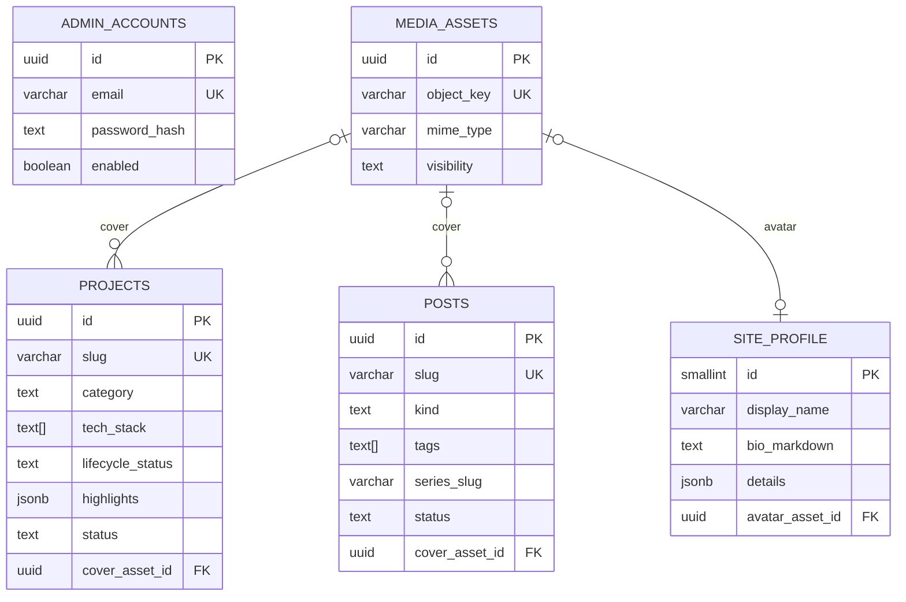

# Thiết kế database v4 — tinh gọn, mở rộng được

Baseline v4 — 22/09/2026. Tài liệu này là **bản chốt để bắt đầu viết migration**, thay cho việc đọc song song tài liệu 04/10/14. Nó giữ tinh thần "vừa đủ" của tài liệu 14 nhưng sửa những chỗ sẽ gây đau khi scale, và nói rõ *vì sao* để bạn tự viết SQL/entity.

Mục tiêu sản phẩm chi phối thiết kế: đây là **portfolio để show off toàn bộ project đã làm**, kèm blog và learning hub. Vậy `projects` là bảng quan trọng nhất; mọi thứ khác phục vụ nó hoặc đến sau.

## 1. Kết luận nhanh

| Quyết định | Chọn | Lý do một dòng |
|---|---|---|
| Số bảng MVP | **5** (4 của tài liệu 14 + `media_assets`) | Show off project cần ảnh/cover; upload URL tùy ý không kiểm soát được |
| Khóa chính | UUID **v7** do ứng dụng sinh | Time-ordered → index B-tree không phân mảnh như UUID v4; không cần extension |
| Trạng thái xuất bản | `status` DRAFT/PUBLISHED/ARCHIVED, **không** có `visibility` | Một tác giả; thêm cột thứ hai chỉ tạo tổ hợp trạng thái vô nghĩa |
| Enum | `text` + CHECK constraint | Đổi giá trị bằng một migration nhỏ, không rebuild type |
| Audit | `created_at`, `updated_at`, `version` trên mọi aggregate | Optimistic lock là AC bắt buộc (409 khi stale) |
| Mảng nhỏ (tags, tech stack) | `text[]` | Filter vài chục bản ghi không cần bảng join; GIN thêm khi đo thấy cần |
| Dữ liệu hồ sơ | 1 hàng `site_profile` + JSONB có DTO validate | Không tạo 6 bảng cho 6 danh sách chỉ hiển thị |
| Tìm kiếm | `search_vector tsvector` generated + GIN, **phase 2** | Rẻ, không cần Elasticsearch; sẵn cho RAG hybrid |
| Đa tác giả | Chưa; đường mở: thêm `author_id` + backfill | YAGNI nhưng phải biết cách thêm không phá dữ liệu |

## 2. Nguyên tắc thiết kế (đọc trước khi viết migration)

1. **Aggregate = bảng gốc + JSONB cho phần "chỉ đọc cùng nhau".** Tách bảng khi dữ liệu có vòng đời riêng, cần query/filter riêng, hoặc cần FK tới nó. Ví dụ: `projects.highlights` là JSONB (chỉ hiển thị cùng project), nhưng `media_assets` là bảng (được nhiều nơi tham chiếu, có quyền và backup riêng).
2. **Không đưa quy tắc nghiệp vụ vào DB nếu Java kiểm tra tốt hơn**, nhưng bất biến dữ liệu (unique, FK, CHECK "published thì phải có published_at") phải ở DB vì đó là nơi cuối cùng bảo vệ dữ liệu khi có bug.
3. **Slug bất biến sau publish**. Muốn đổi thì spec redirect riêng; đây là quyết định SEO, không phải kỹ thuật.
4. **Không xóa cứng nội dung đã publish.** ARCHIVED giữ ID và lịch sử; hard delete chỉ với DRAFT.
5. **Mọi bảng có `status` đều có index partial** `WHERE status = 'PUBLISHED'` trên cột sort của public list. Đây là index duy nhất cần "nghĩ" ở MVP.

## 3. Schema MVP (5 bảng)

### 3.1 admin_accounts

| Cột | Kiểu | Ràng buộc |
|---|---|---|
| id | uuid | PK |
| email | varchar(254) | NOT NULL, UNIQUE, lưu đã lowercase/trim |
| password_hash | text | NOT NULL (BCrypt/Argon2 qua Spring Security) |
| enabled | boolean | NOT NULL DEFAULT true |
| last_login_at | timestamptz | NULL |
| created_at, updated_at | timestamptz | NOT NULL |
| version | bigint | NOT NULL DEFAULT 0 |

Giữ nguyên tài liệu 14. Thêm `last_login_at` vì rẻ và hữu ích cho AC-001.2 (giới hạn thử đăng nhập được xử lý ở Redis/in-memory, không phải cột đếm trong DB).

### 3.2 site_profile (singleton)

| Cột | Kiểu | Ràng buộc |
|---|---|---|
| id | smallint | PK, CHECK (id = 1) |
| display_name | varchar(100) | NOT NULL |
| headline | varchar(200) | NOT NULL |
| bio_markdown | text | NOT NULL |
| avatar_asset_id | uuid | NULL, FK → media_assets |
| details | jsonb | NOT NULL DEFAULT '{}' |
| updated_at | timestamptz | NOT NULL |
| version | bigint | NOT NULL DEFAULT 0 |

`details` chứa: `roles[]`, `greeting`, `company`, `typingTexts[]`, `focusItems[]`, `socials[{platform,url}]`, `skillGroups[{name, items[]}]`, `certifications[{name, year, url?}]`, `publicContact{email?, phone?, location?}`, `customStats[{label, value}]`. Java DTO cụ thể validate từng mảng (giới hạn size, URL chỉ http/https/mailto). Số project/bài viết public **tính từ bảng thật**, không lưu.

Khi nào tách `skills` ra bảng: khi cần filter project theo skill hoặc thống kê. Lúc đó tạo `skills` + `project_skills` và backfill từ JSONB; DTO public giữ nguyên shape để FE không đổi.

### 3.3 projects — trung tâm của portfolio

| Cột | Kiểu | Ràng buộc / ghi chú |
|---|---|---|
| id | uuid | PK |
| slug | varchar(120) | NOT NULL UNIQUE, lowercase `[a-z0-9-]` |
| title | varchar(160) | NOT NULL |
| summary | varchar(500) | NOT NULL |
| body_markdown | text | NOT NULL DEFAULT '' (case study: Context → My contribution → Architecture → Results → Lessons) |
| category | text | NOT NULL, CHECK IN (FULLSTACK, FRONTEND, BACKEND, MOBILE, AI, DEVOPS, OTHER) |
| tech_stack | text[] | NOT NULL DEFAULT '{}', tối đa 30 phần tử (Java validate) |
| role | varchar(120) | NULL — "Backend lead", "Solo" |
| team_size | smallint | NULL, CHECK (team_size > 0) |
| started_on | date | NULL |
| ended_on | date | NULL, CHECK (ended_on IS NULL OR started_on IS NULL OR ended_on >= started_on) |
| lifecycle_status | text | NOT NULL, CHECK IN (BUILDING, COMPLETED, OPERATING, ARCHIVED_PROJECT) |
| repo_url, live_url | varchar(2048) | NULL, chỉ http/https (Java) |
| cover_asset_id | uuid | NULL, FK → media_assets ON DELETE SET NULL |
| highlights | jsonb | NOT NULL DEFAULT '[]' — `[{label, value, note?}]` số liệu/kết quả; ghi "chưa đo" thay vì bịa |
| featured | boolean | NOT NULL DEFAULT false |
| sort_order | integer | NOT NULL DEFAULT 0 |
| status | text | NOT NULL DEFAULT 'DRAFT', CHECK IN (DRAFT, PUBLISHED, ARCHIVED) |
| published_at | timestamptz | NULL, CHECK (status <> 'PUBLISHED' OR published_at IS NOT NULL) |
| created_at, updated_at | timestamptz | NOT NULL |
| version | bigint | NOT NULL DEFAULT 0 |

Khác tài liệu 14: thêm `category`, `role`, `team_size`, `started_on/ended_on`, `cover_asset_id`, `highlights`. Lý do: FE hiện tại đã hiển thị category/emoji/team size; một portfolio "show off" cần timeline và số liệu; cover image là thứ mọi project card cần. `emoji` **không** thành cột — đưa vào `highlights` hoặc bỏ; icon thuộc về presentation.

Gallery nhiều ảnh: **chưa** tạo bảng `project_media`. Khi cần, thêm bảng `project_assets(project_id, asset_id, position, caption)` bằng một migration, không đụng `projects`.

Index MVP:

```text
projects_slug_key                UNIQUE (slug)               -- có sẵn từ UNIQUE
projects_public_list_idx         (featured DESC, sort_order, published_at DESC) WHERE status = 'PUBLISHED'
projects_tech_stack_gin_idx      GIN (tech_stack)            -- chỉ khi filter theo tech thật sự được dùng
```

### 3.4 posts — blog

| Cột | Kiểu | Ràng buộc |
|---|---|---|
| id | uuid | PK |
| slug | varchar(120) | NOT NULL UNIQUE |
| title | varchar(160) | NOT NULL |
| excerpt | varchar(500) | NOT NULL |
| body_markdown | text | NOT NULL |
| kind | text | NOT NULL CHECK IN (TECHNICAL, JOURNEY, REFLECTION) |
| tags | text[] | NOT NULL DEFAULT '{}', lowercase, unique trong mảng (Java) |
| cover_asset_id | uuid | NULL FK → media_assets |
| reading_minutes | smallint | NOT NULL DEFAULT 1 — **tính khi save** từ body (không nhập tay) |
| series_slug | varchar(120) | NULL — xem ghi chú |
| series_position | smallint | NULL, CHECK ((series_slug IS NULL) = (series_position IS NULL)) |
| status, published_at, created_at, updated_at, version | | như projects |

Series: tài liệu 14 nói "thêm bảng series khi cần". Cách rẻ hơn mà vẫn đúng: hai cột `series_slug/series_position` + UNIQUE (series_slug, series_position) WHERE series_slug IS NOT NULL. Khi series cần mô tả/ảnh riêng mới tạo bảng `series` và đổi `series_slug` thành FK. Đây là ví dụ "thiết kế cho phép nâng cấp" thay vì "thiết kế trước cho mọi khả năng".

`reading_minutes` lưu số, không lưu chuỗi "8 min"; FE format.

Index MVP: `posts_public_list_idx (published_at DESC) WHERE status = 'PUBLISHED'`; `posts_tags_gin_idx GIN (tags)` khi có filter tag.

### 3.5 media_assets — bảng mới so với tài liệu 14

| Cột | Kiểu | Ràng buộc |
|---|---|---|
| id | uuid | PK |
| object_key | varchar(512) | NOT NULL UNIQUE — đường dẫn trong storage (local disk/S3-compatible) |
| mime_type | varchar(100) | NOT NULL, allowlist image/png, image/jpeg, image/webp, image/svg+xml (Java) |
| size_bytes | bigint | NOT NULL CHECK (size_bytes > 0) |
| width, height | integer | NULL |
| alt_text | varchar(300) | NOT NULL DEFAULT '' |
| visibility | text | NOT NULL CHECK IN (PUBLIC, PRIVATE) DEFAULT 'PUBLIC' |
| created_at | timestamptz | NOT NULL |

Vì sao cần ngay ở MVP: card project cần cover; dùng URL tùy ý (`cover_url text`) nghĩa là hotlink ảnh ngoài, không kiểm soát kích thước, không backup được, và khi làm visionboard private sẽ phải thiết kế lại. `visibility` ở **asset** là hợp lý (khác với content) vì asset không có publish workflow — nó chỉ public hoặc private.

Storage thực tế: v1 lưu file ở volume persistent, URL public `/media/{object_key}` do Spring phục vụ với cache header; asset PRIVATE đi qua endpoint kiểm tra session. Chuyển sang S3/R2 sau chỉ đổi adapter, schema giữ nguyên.

## 4. ERD MVP



`admin_accounts` không có FK tới nội dung: một tác giả, quyền ghi bảo vệ bằng session. Đây là chỗ khác biệt lớn nhất so với tài liệu 04 (owner_id trên mọi bảng) và là lý do schema nhỏ hơn một nửa.

## 5. Learning Hub — 8 bảng, giữ theo tài liệu 14 với 3 chỉnh sửa

Giữ: `lessons`, `problems`, `problem_sources`, `solutions`, `problem_lessons`, `roadmaps`, `roadmap_sections`, `roadmap_items`.

Chỉnh:

1. `solutions.java_code` → đổi tên **`code`** + cột `language text NOT NULL DEFAULT 'java'` với CHECK. Chi phí bằng 0 hôm nay, tránh migration đổi tên khi thêm ngôn ngữ thứ hai; chưa tạo bảng `code_samples`.
2. `problem_sources.platform_code` CHECK IN (LEETCODE, CODEFORCES, ATCODER, CSES, HACKERRANK, CUSTOM). Không bảng `platforms` — 6 hằng số không cần bảng.
3. `roadmap_items`: giữ CHECK XOR (`(lesson_id IS NULL) <> (problem_id IS NULL)`), và UNIQUE (section_id, position) **DEFERRABLE INITIALLY DEFERRED** để reorder trong một transaction không phải dùng vị trí tạm. Đây là kỹ thuật PostgreSQL đáng học; ghi chú trong migration vì sao.

Tổng sau Learning Hub: **13 bảng**. Tracking (attempts/problem_progress), habit, vision, RAG (documents/chunks/index_jobs) thêm đúng khi làm tính năng, theo tài liệu 14 mục 7.

## 6. Đường mở rộng đã tính trước (không làm bây giờ)

| Nhu cầu tương lai | Thay đổi | Phá vỡ gì? |
|---|---|---|
| Tìm kiếm full-text | Thêm `search_vector tsvector GENERATED ALWAYS AS (to_tsvector('simple', title || ' ' || summary || ' ' || body_markdown)) STORED` + GIN trên projects/posts | Không; một migration, FE chỉ thêm ô search |
| Nhiều tác giả | Thêm `author_id uuid NULL FK → admin_accounts`, backfill = admin đầu tiên, rồi SET NOT NULL | Không, nếu backfill trước khi bật tính năng |
| Nhiều ảnh/project | Bảng `project_assets(project_id, asset_id, position, caption)` | Không |
| Series có trang riêng | Bảng `series`; `posts.series_slug` → FK | Cần migration chuyển dữ liệu, đã có unique nên an toàn |
| Draft song song bản live | Bảng `content_revisions(entity_type, entity_id, revision, snapshot jsonb)` | Không; bản live vẫn ở bảng gốc |
| RAG | `documents/chunks/index_jobs` tham chiếu `(entity_type, entity_id, version)` | Không; `version` đã là revision |
| Tách service | Mỗi nhóm bảng đã không có FK chéo giữa content ↔ learning, trừ `media_assets` dùng chung | Phải quyết định owner của media trước khi tách |
| Chuyển S3/CDN | Chỉ đổi storage adapter; `object_key` giữ nguyên | Không |

Ba thứ **cố ý không** làm để giữ tinh gọn: bảng `tags` riêng, bảng `platforms`, bảng `roles/permissions`. Khi nào cần, dấu hiệu là: có UI quản trị riêng cho thứ đó, hoặc cần FK tới nó.

## 7. Mapping sang Spring/JPA (gợi ý để bạn tự code)

- Một `@MappedSuperclass BaseAuditableEntity { id, createdAt, updatedAt, version }` với `@Version`, `@CreationTimestamp/@UpdateTimestamp` (Hibernate) hoặc Spring Data auditing.
- UUID v7: Hibernate 7 (đi kèm Spring Boot 4) có `@UuidGenerator(style = UuidGenerator.Style.VERSION_7)`; nếu không dùng, sinh trong constructor bằng thư viện nhỏ. Bài tập: giải thích vì sao v7 tốt hơn v4 cho index.
- `text[]` map bằng `List<String>` + `@JdbcTypeCode(SqlTypes.ARRAY)`; `jsonb` map bằng `@JdbcTypeCode(SqlTypes.JSON)` sang record/DTO có kiểu, không dùng `Map<String,Object>`.
- Enum Java ↔ text: `@Enumerated(EnumType.STRING)`; CHECK constraint ở DB là nguồn sự thật, enum Java phải khớp (viết một test đọc metadata để so).
- `spring.jpa.hibernate.ddl-auto=validate`, Flyway sở hữu schema. Migration đầu tiên: `V1__init_portfolio.sql` gồm đúng 5 bảng ở mục 3; không tạo bảng learning trong V1.

## 8. Test tối thiểu phải có khi implement (nhắc lại từ tài liệu 14, sắp theo ưu tiên)

1. Migration chạy trên DB rỗng (Testcontainers) và `ddl-auto=validate` pass.
2. Publish thiếu `published_at` bị CHECK từ chối (test ở DB, không chỉ ở service).
3. Stale `version` → 409; hai request đồng thời chỉ một thành công.
4. Slug trùng → 409; DRAFT/ARCHIVED không lộ qua public API dù biết slug.
5. Xóa asset đang được project dùng → cover về NULL (ON DELETE SET NULL) và không lỗi 500.
6. Reorder roadmap trong transaction không vi phạm unique (khi làm learning).

## 9. Câu hỏi tự kiểm tra trước khi viết migration

- Vì sao `published_at` không reset khi unpublish? Điều gì hỏng nếu reset?
- Nếu `tech_stack` là bảng join thay vì `text[]`, query "project dùng Java" khác nhau thế nào? Khi nào mảng thua?
- `version` của JPA là gì, vì sao 409 cần nó, và tại sao không thể thay bằng `updated_at`?
- Partial index `WHERE status='PUBLISHED'` giúp gì so với index thường?

Trả lời được bốn câu này nghĩa là bạn hiểu schema, không chỉ chép nó.
