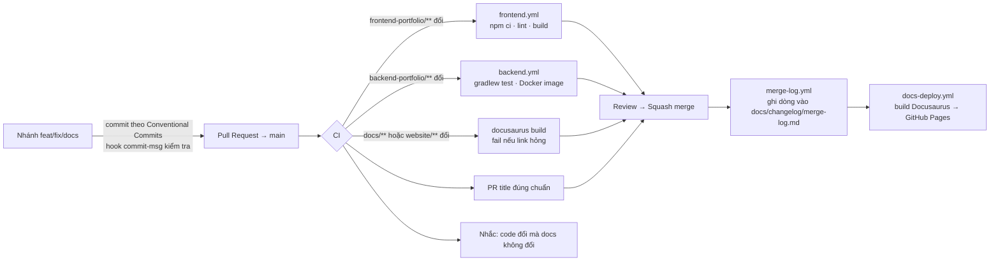

# Quy trình Git, PR, docs và merge log

Ngày: 22/09/2026. Tài liệu này mô tả **cách repo vận hành**: nhánh, commit, PR, CI, cách docs tự cập nhật và cách mỗi lần merge vào `main` được ghi lại. Mọi AI tool và người đóng góp phải theo đúng quy trình này (tham chiếu từ `AGENTS.md`).

## 1. Sơ đồ tổng thể



Phần deploy app (backend lên VPS, frontend lên Vercel) nằm ở [tài liệu 20](20-ci-cd.md).

## 2. Nhánh và commit

- `main` là nhánh bảo vệ: chỉ nhận PR, squash merge, CI xanh. Bảo vệ bằng *ruleset* sau khi push lần đầu: các bước và danh sách check bắt buộc ở [tài liệu 20 mục 3](20-ci-cd.md#3-thiết-lập-github-lần-đầu-làm-một-lần).
- Tên nhánh: `feat/<scope>-<mô-tả>`, `fix/…`, `docs/…`, `chore/…`, `refactor/…`. Ví dụ `feat/be-project-publish`, `docs/db-v4`.
- Commit theo **Conventional Commits**: `type(scope): mô tả` — type ∈ `feat fix docs style refactor perf test build ci chore revert`; scope gợi ý `be`, `fe`, `docs`, `db`, `ci`, `repo`. Hook `.githooks/commit-msg` từ chối commit sai định dạng. Kích hoạt hook một lần trên mỗi máy:

```bash
git config core.hooksPath .githooks
```

- Tiêu đề PR cũng theo chuẩn trên vì squash merge dùng tiêu đề PR làm commit message trên `main`. CI kiểm tra tiêu đề.
- Thay đổi phá vỡ contract: thêm `!` (`feat(be)!: đổi shape ProjectResponse`) và mục `BREAKING CHANGE:` trong body.

## 3. Quy tắc "code đổi thì docs đổi"

PR chạm `backend-portfolio/src/**` hoặc `frontend-portfolio/src/**` mà không chạm `docs/**` sẽ nhận **comment nhắc** từ CI (không chặn). Người mở PR trả lời một trong hai:

- cập nhật docs trong cùng PR (spec, ADR, hoặc `CHANGELOG.md` mục Unreleased), hoặc
- ghi rõ trong mô tả PR vì sao không cần (ví dụ refactor nội bộ không đổi hành vi) — reviewer quyết định.

Tài liệu nào phải đổi khi nào:

| Thay đổi | Cập nhật |
|---|---|
| Endpoint/DTO mới hoặc đổi | Tài liệu 04/10 (contract) + OpenAPI của slice |
| Migration mới | Tài liệu 15 (nếu khác thiết kế) + ghi `CHANGELOG.md` |
| Quyết định kiến trúc | ADR mới trong tài liệu 02 (ADR-0xx) |
| Hoàn thành AC của spec | Tài liệu 05: trạng thái + link evidence trong `docs/evidence/` |
| Thư viện mới | Tài liệu 11 |
| Bài học xong | `docs/mentor/learning-log.md` |

## 4. Docs tự cập nhật thế nào

- Nguồn duy nhất là `docs/`. Docusaurus trong `website/` đọc `../docs` trực tiếp (`docs.path`), không copy.
- `docs-deploy.yml` chạy khi có push vào `main` chạm `docs/**` hoặc `website/**`, hoặc khi được gọi từ `merge-log.yml`. Nó `npm ci` → `npm run build` → deploy GitHub Pages. Link hỏng làm build fail → PR không merge được nếu docs hỏng (job `docs` trong `ci.yml` chạy cùng lệnh build).
- Lần đầu: vào Settings → Pages → Source: **GitHub Actions**. `baseUrl` được CI đặt thành `/<tên-repo>/` nếu là project site; đổi `DOCS_URL`/`DOCS_BASE_URL` trong workflow nếu dùng domain riêng.

## 5. Merge log: mỗi lần merge vào main đều được ghi

`merge-log.yml` chạy khi PR **đã merge** vào `main`. Nó thêm một dòng vào bảng trong `docs/changelog/merge-log.md`:

| Ngày | PR | Loại | Phạm vi | Tiêu đề | Tác giả | Nhãn |
|---|---|---|---|---|---|---|

- *Loại/Phạm vi* lấy từ tiêu đề PR (`feat(be): …` → `feat`, `be`).
- *Phạm vi thư mục* tự suy ra từ file thay đổi: `backend`, `frontend`, `docs`, `ci`, `repo`.
- PR có nhãn `major` hoặc tiêu đề có `!` được in đậm và thêm vào mục **Mốc lớn** đầu file — đây là "log mỗi lần merge lớn" bạn yêu cầu; PR nhỏ vẫn có dòng nhưng không nổi bật.
- Workflow commit bằng `github-actions[bot]` với message `docs(changelog): log merge of #<n> [skip ci]`, push bằng deploy key `MERGE_LOG_DEPLOY_KEY` (nằm trong bypass list của ruleset `main`), rồi gọi deploy docs tường minh bằng `workflow_call`. `[skip ci]` ngăn commit này kích hoạt lại các workflow push.

`CHANGELOG.md` ở root là bản **do người viết** theo Keep a Changelog: ghi *ý nghĩa* của thay đổi (thêm bảng X, đổi contract Y), không phải danh sách PR. Merge log là máy ghi; CHANGELOG là người kể. Khi release v1, có thể bật release-please để tự gom.

## 6. Checklist PR (đã có trong `.github/PULL_REQUEST_TEMPLATE.md`)

- [ ] Tiêu đề theo Conventional Commits, có scope.
- [ ] Link spec/AC hoặc bài học liên quan.
- [ ] Docs cập nhật hoặc giải thích vì sao không.
- [ ] Lint/test/build pass ở local (ghi lệnh đã chạy).
- [ ] Không có secret, `.env`, file build trong diff.
- [ ] Với migration: đã chạy trên DB rỗng và có kế hoạch rollback.

## 7. Lệnh hằng ngày

```bash
# bắt đầu việc mới
git switch main && git pull
git switch -c feat/be-project-entity

# trước khi commit backend
cd backend-portfolio && ./gradlew.bat test

# trước khi commit frontend
cd frontend-portfolio && npm run lint && npm run build

# trước khi commit docs
cd website && npm run build

# commit
git add -A && git commit -m "feat(be): add Project entity and V1 migration"

# mở PR
gh pr create --fill
```
