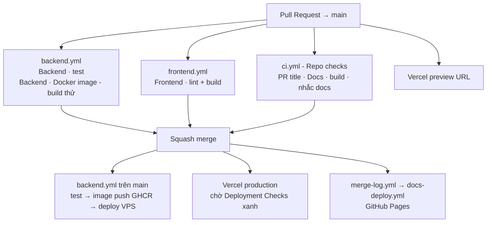

# CI/CD cho backend, frontend và docs

Ngày: 23/09/2026. Trạng thái: **workflow đã cấu hình**. Deploy backend đang **tắt** cho đến khi có VPS (biến `BACKEND_DEPLOY`); deploy frontend chờ bạn import repo vào Vercel. Quyết định nền: [ADR-012](02-stack-decisions.md#adr-012--deploy-fe-trên-vercel-be-trên-vps-cùng-origin-qua-rewrite-proxy).

## 1. Sơ đồ



## 2. Các workflow

| File | Chạy khi | Làm gì |
|---|---|---|
| `.github/workflows/backend.yml` | Mọi PR vào `main`; push `main` chạm `backend-portfolio/**`; chạy tay | `./gradlew test` (Testcontainers) → build Docker image (PR: chỉ build; `main`: push GHCR) → deploy VPS qua SSH |
| `.github/workflows/frontend.yml` | Mọi PR vào `main`; push `main` chạm `frontend-portfolio/**`; chạy tay | `npm ci` → `npm run lint` → `npm run build`. Deploy do Vercel làm |
| `.github/workflows/ci.yml` (Repo checks) | Mọi PR | Tiêu đề PR đúng Conventional Commits; build Docusaurus khi `docs/`/`website/` đổi; nhắc cập nhật docs |
| `.github/workflows/docs-deploy.yml` | Push `main` chạm docs; được gọi từ merge-log; chạy tay | Build Docusaurus → GitHub Pages |
| `.github/workflows/merge-log.yml` | PR đã merge | Ghi `docs/changelog/merge-log.md` → deploy docs |
| `.github/dependabot.yml` | Hằng tháng | PR gom nhóm cập nhật minor/patch cho Gradle, npm, Docker, Actions |

**Vì sao PR không lọc path ở trigger?** Nếu workflow bị bỏ qua do `paths`, check bắt buộc của nó nằm "Pending" mãi và PR không merge được. Nên workflow luôn chạy, job `… · detect changes` (dorny/paths-filter) quyết định có test hay không. Job bị skip do `if` được GitHub tính là **pass**. Push lên `main` thì lọc path ở trigger để không build/deploy thừa.

Chạy lại ở máy trước khi push:

| Phần | Lệnh (PowerShell) |
|---|---|
| Backend | `cd backend-portfolio; .\gradlew.bat test` (cần Docker Desktop đang chạy) |
| Backend image | `docker build -t portfolio-backend backend-portfolio` |
| Frontend | `cd frontend-portfolio; npm run lint; npm run build` |
| Docs | `cd website; npm run build` |

## 3. Thiết lập GitHub lần đầu (làm một lần)

1. **Tạo repo rỗng** trên GitHub (không tick README/.gitignore/license vì repo local đã có). Public nếu muốn GitHub Pages miễn phí.
2. **Push commit đầu**:

   ```bash
   git remote add origin https://github.com/<owner>/<repo>.git
   git push -u origin main
   ```

3. **Pages**: Settings → Pages → Source = **GitHub Actions**.
4. **Kiểu merge**: Settings → General → Pull Requests → chỉ bật *Allow squash merging* (Default commit message = *Pull request title*), bật *Automatically delete head branches*.
5. **Deploy key cho merge log** (bước 6 chặn push trực tiếp, kể cả của bot):

   ```bash
   ssh-keygen -t ed25519 -N "" -C "merge-log" -f merge-log-key
   ```

   `merge-log-key.pub` → Settings → Deploy keys → Add, **tick Allow write access**. Nội dung `merge-log-key` (private) → Settings → Secrets and variables → Actions → secret `MERGE_LOG_DEPLOY_KEY`. Xóa hai file trên máy sau khi dán.
6. **Bảo vệ `main`** bằng ruleset: Settings → Rules → Rulesets → New branch ruleset.
   - Target: *Default branch*. Enforcement: *Active*.
   - Bypass list: **Deploy keys** (để merge-log push được). Không thêm gì khác.
   - Rules: *Restrict deletions*, *Block force pushes*, *Require a pull request before merging* (Required approvals = 0 vì bạn làm một mình), *Require status checks to pass* với 4 check:
     `Backend · test`, `Frontend · lint + build`, `Docs · build`, `PR title (Conventional Commits)`.
   - Check chỉ hiện trong ô tìm kiếm **sau khi đã chạy ít nhất một lần**. Mở một PR nhỏ trước, rồi quay lại thêm check.
7. **Environment**: Settings → Environments → New `production` → Deployment branches: *Selected branches* = `main`. Secret của VPS (mục 4) đặt ở đây.

Lần push đầu có thể chạy tất cả workflow. `Frontend · lint + build` sẽ **đỏ** cho đến khi sửa các lỗi lint đã biết ([Lesson 01](mentor/lessons/lesson-01-foundation.md) phần 3). Đó là trạng thái thật của code, không phải lỗi pipeline.

## 4. Backend: GHCR → VPS

### Image

- Tên: `ghcr.io/<owner-chữ-thường>/<repo-chữ-thường>-backend`. Tag `sha-<commit đầy đủ>` (bất biến, dùng để deploy/rollback) và `latest` (bản mới nhất của `main`).
- `backend-portfolio/Dockerfile` build nhiều stage: JDK 21 chạy Gradle Wrapper `bootJar`, tách jar thành layer (`-Djarmode=tools extract --layers`), rồi chạy trên JRE 21 bằng user không phải root. Pull bản mới thường chỉ tải lại layer `application`.
- Package mới trên GHCR mặc định **private**; workflow đăng nhập GHCR trên VPS bằng token tạm của job nên không cần đổi.

### Biến và secret

| Tên | Loại | Ở đâu | Ví dụ / ghi chú |
|---|---|---|---|
| `BACKEND_DEPLOY` | Variable | **Repository** (job `if` không đọc được biến của environment) | `true` để bật deploy; xóa/đổi giá trị để tắt |
| `VPS_HOST` | Variable | Repository hoặc `production` | `api.example.com` |
| `VPS_USER` | Variable | như trên | `deploy` |
| `VPS_DEPLOY_PATH` | Variable | như trên | `/opt/portfolio` |
| `BACKEND_HEALTH_URL` | Variable | như trên, tùy chọn | `https://api.example.com/actuator/health`; không đặt thì bỏ qua health check |
| `VPS_SSH_KEY` | Secret | `production` | Private key ed25519 **riêng cho CI**, không dùng key cá nhân |
| `VPS_KNOWN_HOSTS` | Secret | `production` | Kết quả `ssh-keyscan -t ed25519 <VPS_HOST>`; đối chiếu fingerprint với VPS trước khi dán |

### VPS cần chuẩn bị gì

1. Docker Engine + plugin `docker compose`; user `deploy` thuộc group `docker`; public key của CI nằm trong `~deploy/.ssh/authorized_keys`.
2. Thư mục `VPS_DEPLOY_PATH` chứa `compose.yaml` **do bạn viết** (bài vận hành) với Postgres, reverse proxy HTTPS (Caddy/nginx) và một service tên **`backend`**. Đây là hợp đồng duy nhất pipeline cần:

   ```yaml
   services:
     backend:
       image: ghcr.io/<owner>/<repo>-backend:${BACKEND_TAG:-latest}
       env_file: .env        # SPRING_DATASOURCE_URL/USERNAME/PASSWORD… chỉ nằm trên VPS
       restart: unless-stopped
   ```

3. `.env` trên VPS không bao giờ vào git. Pipeline không đọc, không ghi file này.

### Một lần deploy diễn ra thế nào

1. SSH bằng key và `known_hosts` cố định (không dùng `StrictHostKeyChecking=no`).
2. `docker login ghcr.io` bằng `GITHUB_TOKEN` truyền qua stdin; token hết hạn khi job xong và bị `docker logout` ngay sau khi pull.
3. `BACKEND_TAG=sha-<commit> docker compose pull backend && docker compose up -d --no-deps backend`.
4. Spring Boot khởi động → **Flyway chạy migration** → app lên. Migration là một chiều: rollback image **không** rollback schema, nên migration phải tương thích ngược với bản trước (thêm cột nullable trước, xóa cột ở release sau).
5. Poll `BACKEND_HEALTH_URL` tối đa 150 giây, chờ `"status":"UP"`.

### Rollback

- Actions → *Backend CI/CD* → mở run của commit tốt gần nhất → *Re-run jobs* → chọn `Backend · deploy VPS`. Job dùng lại `sha-<commit>` của run đó.
- Hoặc trên VPS: `BACKEND_TAG=sha-<commit> docker compose up -d --no-deps backend`.

## 5. Frontend: Vercel Git integration

Vercel tự build và deploy mỗi push (preview cho PR, production cho `main`). GitHub Actions chỉ làm CI. Cấu hình:

1. vercel.com → Add New → Project → Import repo → **Root Directory = `frontend-portfolio`**. Framework tự nhận Vite. Node.js Version khớp CI (24.x nếu Vercel có, không thì 22.x).
2. Bỏ qua build khi frontend không đổi: đã cấu hình trong `frontend-portfolio/vercel.json` (`ignoreCommand: git diff --quiet HEAD^ HEAD ./`), không cần đặt trong dashboard.
3. **Chặn production khi CI đỏ**: Project Settings → Deployment Checks → Add Checks → GitHub → chọn `Frontend · lint + build`. Vercel vẫn build, nhưng chỉ promote lên production khi check này xanh.
4. Khi backend có domain: thay `REPLACE_WITH_DOMAIN` trong `frontend-portfolio/vercel.json` (rewrite `/api/*` → VPS, xem tài liệu 16).

## 6. Dependabot

Hằng tháng, mỗi hệ sinh thái tối đa 2–3 PR, gom nhóm. **Bỏ qua bản major**: nâng major (Tailwind 3→4, Spring Boot 4→5) phải có chủ đích, qua bài học/ADR. PR của Dependabot có tiêu đề `build(deps): …`/`ci(deps): …` nên qua check tiêu đề, và CI của phần tương ứng chạy như mọi PR khác.
