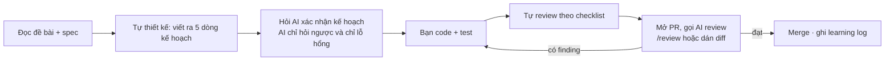

# Học & Mentor — bạn code, AI hướng dẫn và review

Khu vực này là "lớp học" của dự án. Nguyên tắc cốt lõi được ghi trong `AGENTS.md` ở root và áp dụng cho **mọi** AI tool (Claude Code, Cursor, Copilot, Gemini CLI, ChatGPT...):

> **AI không viết code ứng dụng thay bạn.** AI giải thích, đặt câu hỏi, gợi ý theo tầng, review và chỉ ra lỗi. Bạn là người gõ từng dòng trong `backend-portfolio/` và `frontend-portfolio/`.

## Có gì ở đây

| Trang | Dùng khi |
|---|---|
| [Cách làm việc với mentor](how-we-work.md) | Đọc đầu tiên. Quy ước hỏi/đáp, tầng gợi ý, khi nào AI được viết code mẫu |
| [Syllabus](syllabus.md) | Lộ trình bài học bám theo 18 sprint; mỗi bài có mục tiêu, bài tập, tiêu chí đạt |
| [Checklist review](review-checklists.md) | Bạn tự review trước, rồi AI review theo cùng checklist |
| [Bài học](lessons/lesson-01-foundation.md) | Từng bài với đề bài, câu hỏi dẫn dắt, bẫy thường gặp |
| [Learning log](learning-log.md) | Nhật ký học: ngày, làm gì, sai gì, hiểu ra gì |

## Vòng lặp một bài học

## Gọi mentor thế nào

- **Claude Code**: gõ `/mentor <câu hỏi>` để vào chế độ dạy; `/review` để review diff hiện tại; `/spec` để viết spec trước khi code; `/db-migration` khi động vào Flyway.
- **Tool khác**: mở đầu bằng "Đọc AGENTS.md và .claude/skills/mentor/SKILL.md rồi hướng dẫn tôi làm bài X". Các file đó là văn bản thường, tool nào cũng đọc được.
